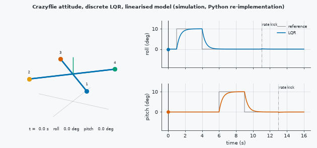
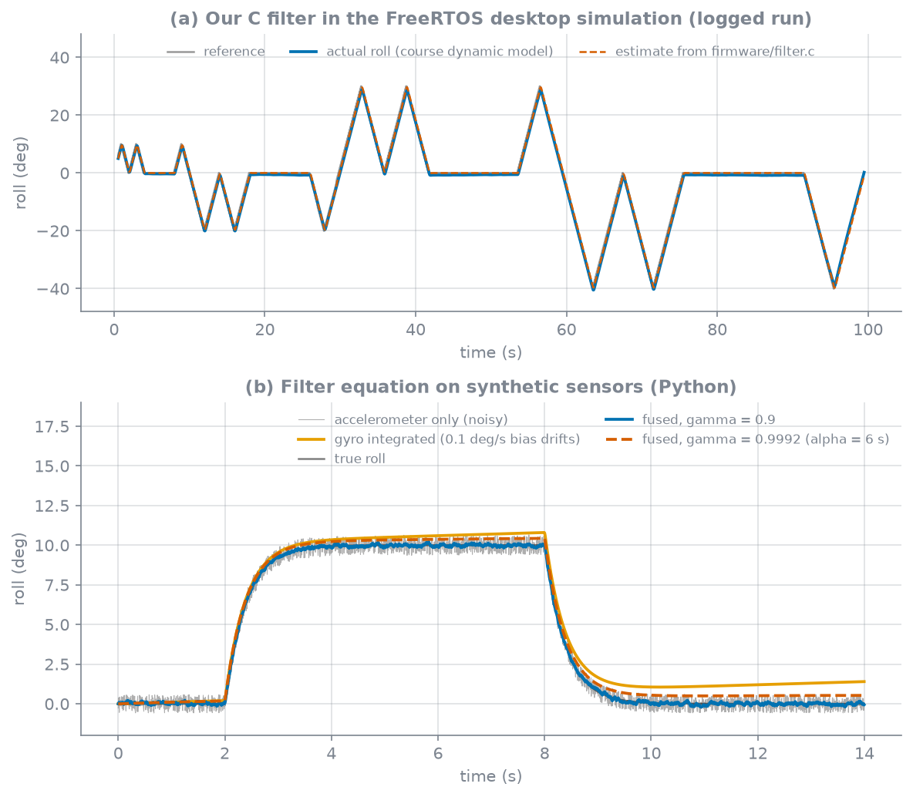
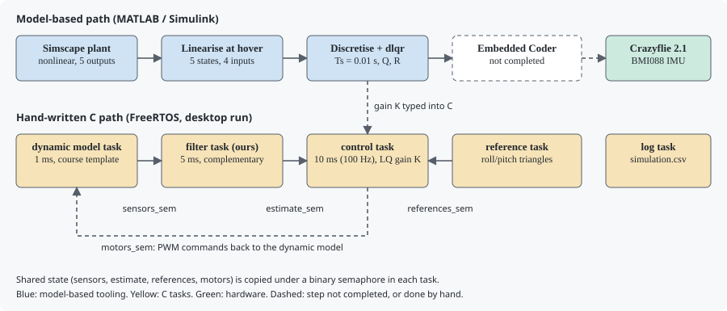
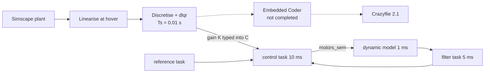
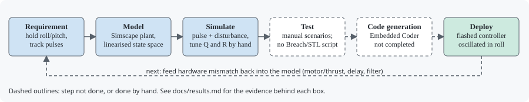

# Crazyflie quadrotor: LQR attitude control, filter and FreeRTOS tasks

A discrete LQR for roll and pitch, a complementary filter and a FreeRTOS implementation for a Crazyflie 2.1, from the
Chalmers course SSY191 (Model-Based Development of Cyber-Physical Systems). Validated in simulation. On the real drone the controller oscillated.



*Attitude only, linearised model. The animation is a Python re-implementation of the report's model, not the team's Simulink model.*

## TL;DR

This was a four-person course project. I wrote the complementary filter and fixed a semaphore bug and a filter constant in the
C code. The model, the LQR design and most of the FreeRTOS tasks are team work. This repo collects our results and re-derives the model
in Python so the figures can be regenerated. It also says where the project fell short.

- Simulation: the discrete LQR (Ts = 0.01 s) tracks a 10 deg roll or pitch pulse with a 0.85 s rise time and no overshoot, and rejects a rate kick with a 0.14 deg excursion (Python re-implementation).
- Hardware: the controller oscillated in roll (about +-5 to +-7 deg) and pitch sat near 30 deg. The Embedded Coder port was not completed.
- Scope: roll and pitch are stabilised, with yaw-rate feedback. Yaw angle is not stabilised.

## My contribution vs. team

My main ownership in the project was the complementary filter. I do not remember further details of my share of the Simulink work, so I claim nothing beyond the filter and the commits listed below.

| Area | Mine | Team |
|---|---|---|
| Complementary filter in C (`firmware/filter.c`), `xSemaphoreGive` fix, filter gamma fix | yes (3 of the 11 student commits in the FreeRTOS part, from `git log` of the original repo) | Later edits to the filter period and `vTaskDelayUntil` are a teammate's |
| LQ controller task in C (`firmware/controller.c`) | no, apart from the semaphore fix | teammates |
| Simscape plant, linearisation, LQR design and weights | not claimed | team (report, 4 authors; I am second author) |
| Python re-implementation, figures, analysis scripts, this repo | yes, written after the course | |
| Reference generator, dynamic model, main, FreeRTOS kernel | no | course template, not included |

Details and the evidence for each row are in [`firmware/README.md`](firmware/README.md).

## Skills demonstrated

| Skill | Evidence | Whose |
|---|---|---|
| State-space modelling, linearisation at hover | [`docs/model.md`](docs/model.md), `analysis/common.py` | Re-derived by me from the report; original model is team work |
| Discrete LQR design and weight trade-offs | [`media/poles_qr.png`](media/poles_qr.png), [`media/response.png`](media/response.png) | Same as above |
| Complementary filter, sensor fusion | [`firmware/filter.c`](firmware/filter.c), [`media/filter.png`](media/filter.png) | Mine |
| Embedded C, FreeRTOS tasks, semaphores, periodic timing | [`firmware/filter.c`](firmware/filter.c), [`firmware/controller.c`](firmware/controller.c) | Filter mine; controller team |
| Simscape / Simulink physical modelling | Report appendix A, summarised in [`simulink/README.md`](simulink/README.md); models are not in this repo | Team |
| Code generation (Embedded Coder) | Attempted, not completed | Team |
| Sim-to-real debugging | [`media/report_fig7_hardware.png`](media/report_fig7_hardware.png), [`docs/results.md`](docs/results.md); cause not resolved | Team |
| Python (numpy, scipy, python-control, matplotlib) | [`analysis/`](analysis/) | Mine |
| MATLAB | Course Simulink/Simscape work; no MATLAB code of mine is in this repo | Team |
| Git and teamwork | Commit history of the original repo | Team |

Breach/STL falsification is not listed: there is no script in the repositories I have, and the report does not mention it.

## Results

### Pulse and disturbance response (simulation)


Python re-implementation of the linearised model, with the report's Q, R and Ts. Pulse amplitude and disturbance are my choice;
the report does not give them. The report has no baseline controller, so the comparison is against a softer R and no feedback.
The dashed green line applies the report's printed K to the derived plant; it is stable and nearly identical to the blue line.

### Poles and the Q/R trade-off


All five closed-loop poles are inside the unit circle (largest magnitude 0.9745). With R = I the control-effort term barely matters;
rise time only changes once R is scaled by about 1e3 or more ([`docs/model.md`](docs/model.md)).

### Complementary filter



(a) is a logged run of our C filter in the course's desktop simulation (RMS error 0.71 deg roll, 0.77 deg pitch). (b) runs the same
equation in Python on synthetic sensors with a 0.1 deg/s gyro bias. The report chose gamma = 0.9. The C code computes gamma = 6/(0.005+6) = 0.9992, which tracks more slowly (see mismatches below).

### On the real Crazyflie


*Figure 7 of the project report, cropped. Not regenerated from data; I do not have the log.* Roll oscillates throughout, pitch is offset by about 30 deg, yaw drifts.
The report points to the battery on top of the frame and says the C implementation could not be finished. No experiment separated the causes.
I do not remember which firmware produced this log, and the report does not say.

### Limitations and mismatches

- Simulation results come from my Python re-implementation, not from the team's Simulink model.
- The report's gain matrix is reproduced only if B is scaled by about 0.79; I found no physical reason ([`docs/results.md`](docs/results.md)).
- `controller.c` uses a third gain set, and `filter.c` uses gamma = 0.9992, not the report's 0.9.
- Hardware evidence is one figure from the report.

## System architecture and workflow







We went from requirement to model to tuning in simulation. Testing was manual scenarios, and code generation was not completed. Flashing a controller onto the drone showed the sim-to-real gap.

## How to reproduce

```bash
python3 -m venv .venv && . .venv/bin/activate
pip install -r requirements.txt
make figures
```

This regenerates every figure in `media/` except `report_fig7_hardware.png` and writes the numbers to `docs/metrics/*.json`.
`media/report_fig7_hardware.png` is a crop of the report. To crop it yourself:
`pdftoppm -f 5 -l 5 -r 250 -x 1080 -y 860 -W 890 -H 490 -png <report.pdf> media/report_fig7_hardware`.

The Simulink models are not included; see [`simulink/README.md`](simulink/README.md). The C files need the course template to build
([`firmware/README.md`](firmware/README.md)); the logged run used for the filter figure is in `analysis/data/`.

## What I'd do next

- Retune the LQR on a model that includes the motor and thrust dynamics, since the model assumes thrust follows the command instantly.
- Check the thrust-to-PWM conversion and the battery effect on thrust; the hardware offset in pitch suggests the model and drone disagree about hover thrust or balance.
- Model the filter and the 100 Hz loop delay inside the simulation and see whether they explain the roll oscillation.
- Set gamma by a frequency-domain argument instead of trial and error, and resolve the 0.9 vs. 0.9992 mismatch.
- Estimate yaw angle if yaw needs to be held, and finish the code-generation path so the simulated controller and the flashed one are the same code.

## Acknowledgements

- Chalmers SSY191 course staff for the template, the Crazyflie setup and the lecture notes.
- Teammates (report authors, in report order): Anirudh Vinod Nair, Adyuth Hisham Babu Syed, Andreas Särnholm, David Mörck.
- Upstream: [Bitcraze Crazyflie firmware](https://github.com/bitcraze/crazyflie-firmware) (GPL-3.0, not included), [FreeRTOS kernel](https://github.com/FreeRTOS/FreeRTOS-Kernel) (not included), [python-control](https://github.com/python-control/python-control).
- Project report: four authors, SSY191 Group 7, 2025. Not included in this repo.

No licence is set for this repo, so all rights are reserved by default.
