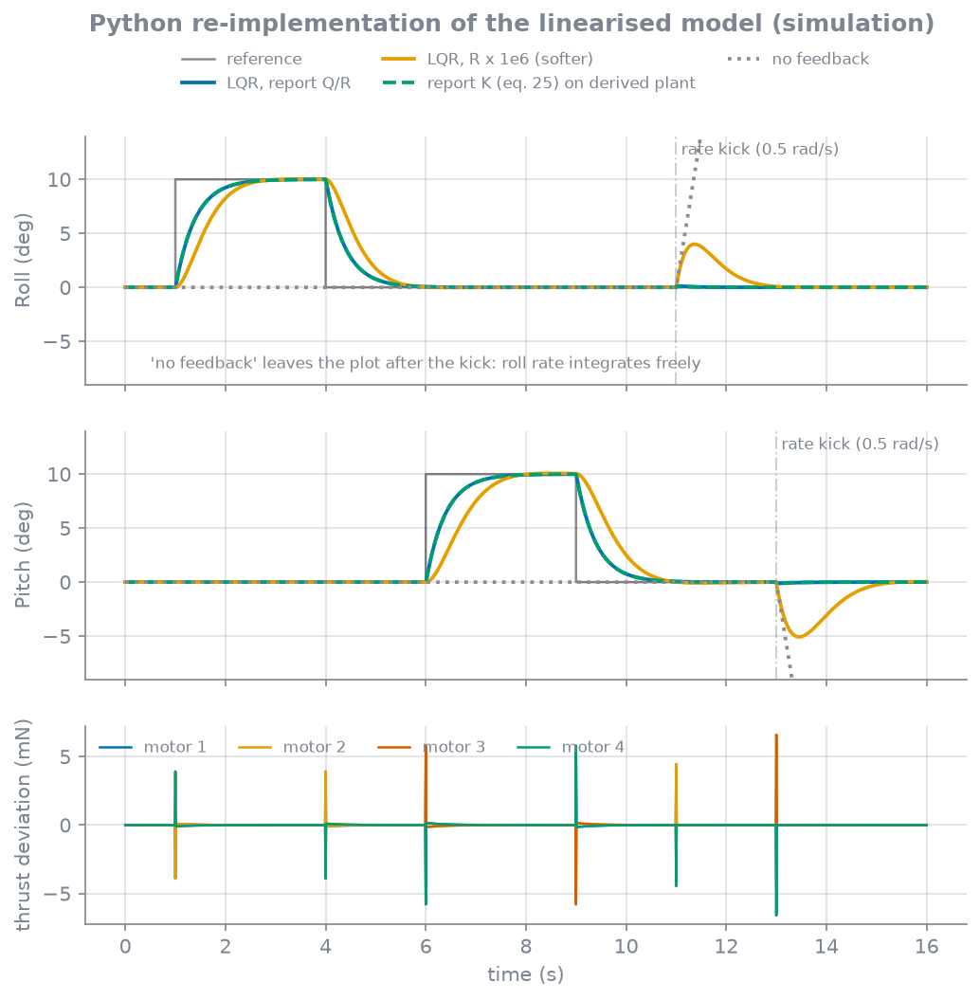
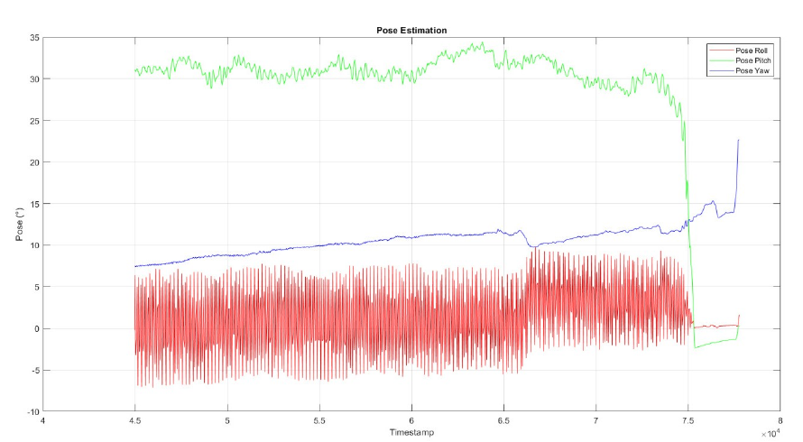

# Crazyflie quadrotor: LQR attitude control and complementary filter


*Attitude only, linearised model. This is a Python re-implementation of the report's model, not the team's Simulink model.*

## The project

SSY191 (Chalmers, Model-Based Development of Cyber-Physical Systems) asks a team to take a Crazyflie 2.1 quadrotor from a physical
model to a controller running on the drone. The goal was to hold roll and pitch and track reference changes. It was a four-person
team project. I took ownership of the complementary filter and was heavily involved in testing the code on the Crazyflie hardware.
The model, the LQR design and the rest of the C tasks are team work.

## What was done

1. **Model.** A nonlinear Simscape model of the quadrotor (thrust and torque from four rotors, rigid-body dynamics), linearised at hover
   into five states (roll, roll rate, pitch, pitch rate, yaw rate) and four rotor-thrust inputs. Equations and constants are in [`docs/model.md`](docs/model.md).
2. **Controller.** A discrete LQR at Ts = 0.01 s, with Q = diag(2, 0.3, 2, 0.3, 0.5) and R = I, tuned by trial in simulation.
3. **Estimator.** A complementary filter turns accelerometer and gyro data into roll and pitch angles (next section).
4. **Embedded implementation.** The filter and controller as FreeRTOS tasks in C, run in a desktop simulation. The Simulink-to-C path
   with Embedded Coder was not completed.
5. **Hardware test.** The controller was flashed to the drone and oscillated in roll (see Results).


The C side has five tasks: a dynamic model (1 ms), our filter (5 ms), the LQ controller (10 ms, 100 Hz), a reference generator and a
logger. They share sensor data, the angle estimate, references and motor commands through binary semaphores.

## The complementary filter

An accelerometer gives the roll angle directly from the direction of gravity, but it is noisy and corrupted whenever the drone accelerates.
A gyro gives a clean angular rate, but integrating it accumulates the sensor's bias as drift. The filter takes the short-term
signal from the gyro and the long-term reference from the accelerometer:

```
roll_acc  = atan2(a_y, a_z)
pitch_acc = atan2(-a_x, sqrt(a_y^2 + a_z^2))
theta_k   = (1 - gamma) * theta_acc + gamma * (theta_{k-1} + h * gyro_k)
```


*Synthetic data from the Python model with a 0.1 deg/s gyro bias and 0.1 m/s^2 accelerometer noise (the course simulator's sensor model). Gamma = 0.9 as in the report.*

In this run the gyro-only estimate drifts to 4 deg of error after 40 s, the accelerometer alone is noisy at about 0.3 deg, and the fused
estimate stays near 0.06 deg (mean absolute errors over the run: 2.0, 0.29 and 0.06 deg).

How it is written in C ([`firmware/filter.c`](firmware/filter.c)):

- A FreeRTOS task wakes every 5 ms with `vTaskDelayUntil`, so the period does not slip with the task's own run time.
- It copies gyro and accelerometer data under `sensors_sem`, computes the update for roll and pitch, and writes the result under `estimate_sem`
  so the 100 Hz controller never reads a half-written estimate.
- Yaw is not estimated (the filter outputs 0), because the controller feeds back yaw rate only.

One mismatch: the report chose gamma = 0.9, but the C code computes gamma = alpha / (h + alpha) with alpha = 6 and h = 5 ms, which is 0.9992.
That weights the gyro almost completely, with a time constant of about 6 s.


(a) is a logged run of the C filter in the course's desktop simulation: the estimate stays within 1.7 deg of the true roll (RMS 0.71 deg) over 99.5 s.
(b) compares gamma = 0.9 and 0.9992 on synthetic data. The higher gamma lags the true motion more (RMS 0.39 deg against 0.08 deg).

## Results

### Simulation



With the report's weights, a 10 deg pulse in roll or pitch rises in 0.85 s (10-90 %) and settles in 1.5 s with no overshoot. A 0.5 rad/s rate kick moves roll by
0.14 deg, while without feedback the same kick reaches 57 deg within 2 s. Pulse size and kick are my choices, since the report does not give them. Peak thrust
deviation is 6.6 mN per motor.


All five closed-loop poles are inside the unit circle (largest magnitude 0.9745). With R = I the control-effort term barely matters, and rise time only changes once R is
scaled by about 1e3 or more.

### On the Crazyflie



*Figure 7 of the project report, cropped. Not regenerated from data.* Roll oscillates throughout (about +-5 to +-7 deg peaks), pitch sits near 30 deg and yaw drifts. The
controller stabilises roll and pitch with yaw-rate feedback; yaw angle is not stabilised. The report points to the battery on top of the frame and says the C implementation could not
be finished. No experiment separated the causes.

### Limitations

- Simulation results come from a Python re-implementation, not the team's Simulink model, which is not available.
- The report's gain matrix is reproduced only if B is scaled by about 0.79. I found no physical reason ([`docs/results.md`](docs/results.md)).
- `controller.c` uses a different gain set from the report, and `filter.c` uses gamma = 0.9992 instead of 0.9.
- Hardware evidence is one figure from the report.

## Reproduce

```bash
python3 -m venv .venv && . .venv/bin/activate
pip install -r requirements.txt
make figures
```

This regenerates every figure in `media/` except `report_fig7_hardware.png` (a crop of the report) and writes the numbers to `docs/metrics/*.json`.
The Simulink models are not included ([`simulink/README.md`](simulink/README.md)). The C files need the course template to build ([`firmware/README.md`](firmware/README.md)).
Sources, data and mismatches for every number are in [`docs/results.md`](docs/results.md).
