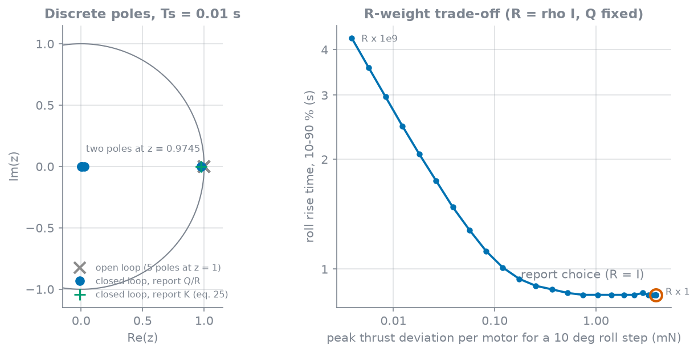
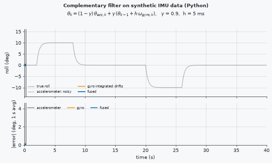

# Crazyflie quadrotor: LQR attitude control and complementary filter

> What is this project about?
> Making a 27 g Crazyflie 2.1 hold its roll and pitch: model it, design a controller, estimate its attitude from an IMU, and run it as real-time C code. A four-person SSY191 course project (Chalmers). I took ownership of the complementary filter and was heavily involved in testing the code on the Crazyflie hardware.


*Attitude only, linearised model (Python re-implementation).*

## TLDR (In brief)

- **Problem:** stabilise roll and pitch of a quadrotor and track reference changes, using only an accelerometer and a gyro for feedback.
- **Approach:** a Simscape model linearised at hover, a discrete LQR (Ts = 0.01 s), a complementary filter for the angles, and FreeRTOS tasks in C.
- **Results:** in simulation a 10 deg pulse rises in 0.85 s with no overshoot, and the filter holds roll within 1.7 deg of the truth in a 99.5 s run. On the real drone the controller oscillated in roll, and the Embedded Coder port was not completed.

## Repo map

```
README.md
analysis/   Python scripts that regenerate every figure (+ data/ with a logged C simulation run)
docs/       model notes (model.md), data sources and mismatches (results.md), metrics/*.json
firmware/   our C files: filter.c/.h (mine), controller.c/.h (team)
media/      figures and animations used here
simulink/   public Crazyflie constants (params.m) and a note on the models
```

## Problems we had to solve

1. **Model.** A quadrotor is nonlinear and coupled. We needed a model simple enough to design a controller on.
2. **Control.** Hold roll and pitch, follow reference pulses and reject disturbances, with four motors as the only actuators.
3. **Attitude estimate.** The accelerometer is noisy and the gyro drifts, and neither gives a usable angle alone. (my part)
4. **Real-time implementation.** Sensors, filter, controller and references run at different rates and share data, so reads and writes must not collide.
5. **Model to hardware.** Get the simulated controller running on the real drone.

## Approach we took

- **Model and control (team).** A Simscape model of the thrust and torque from four rotors, linearised at hover into five states (roll, roll rate, pitch, pitch rate, yaw rate) with four thrust inputs. A discrete LQR with Q = diag(2, 0.3, 2, 0.3, 0.5) and R = I, tuned by trial in simulation. Details: [`docs/model.md`](docs/model.md).
- **Estimation (mine).** A complementary filter: the gyro supplies the short-term motion, the accelerometer pins the long-term angle.

  ```
  roll_acc  = atan2(a_y, a_z)
  pitch_acc = atan2(-a_x, sqrt(a_y^2 + a_z^2))
  theta_k   = (1 - gamma) * theta_acc + gamma * (theta_{k-1} + h * gyro_k)
  ```

  It runs as a FreeRTOS task every 5 ms (`vTaskDelayUntil`), copies sensor data under `sensors_sem`, and writes the estimate under `estimate_sem` so the 100 Hz controller never reads a half-written value. Yaw is not estimated; the controller feeds back yaw rate only. Code: [`firmware/filter.c`](firmware/filter.c).
- **Implementation (team, filter mine).** Five C tasks (dynamic model, filter, controller, reference generator, logger) sharing state through binary semaphores. I also took part in the hardware testing.


## Our solutions

### 1 and 2. Model and controller: solved in simulation

With the LQR, a 10 deg pulse in roll or pitch rises in 0.85 s (10-90 %) and settles in 1.5 s with no overshoot. A 0.5 rad/s rate kick moves roll by 0.14 deg; without feedback the same kick reaches 57 deg within 2 s. Peak thrust deviation is 6.6 mN per motor.


All five closed-loop poles are inside the unit circle (largest magnitude 0.9745). With R = I the control-effort term barely matters; rise time only changes once R is scaled by about 1e3 or more.



### 3. Attitude estimate: solved with the complementary filter

On synthetic IMU data (0.1 deg/s gyro bias, 0.1 m/s^2 accelerometer noise) the gyro-only estimate drifts to 4 deg of error after 40 s and the accelerometer alone sits at about 0.3 deg of noise. The fused estimate stays near 0.06 deg (mean absolute errors over the run: 2.0, 0.29 and 0.06 deg).



The C implementation was also run inside the desktop FreeRTOS simulation: the estimate stays within 1.7 deg of the true roll (RMS 0.71 deg) over 99.5 s. The second panel shows the effect of gamma: a larger gamma trusts the gyro more and lags real motion more (RMS 0.39 deg at 0.9992 against 0.08 deg at 0.9).


### 4. Real-time implementation: solved in the desktop simulation

The five tasks ran together for the full 100 s reference sequence with the semaphore-protected shared state, and the logged run above comes from it.

### 5. Model to hardware: not solved

The controller was flashed to the drone and oscillated in roll (about +-5 to +-7 deg peaks), with pitch near 30 deg and yaw drifting. It stabilises roll and pitch with yaw-rate feedback; yaw angle is not stabilised. The Embedded Coder port was not completed. The report points to the battery on top of the frame as a likely cause; no experiment separated the causes.


*Figure 7 of the project report, cropped.*

## How to run (Including limitations)

```bash
python3 -m venv .venv && . .venv/bin/activate
pip install -r requirements.txt
make figures
```

This regenerates every figure in `media/` and the numbers in `docs/metrics/*.json`. It is not a full reproduction:

- The Simulink/Simscape models are not included, so simulation figures come from a Python re-implementation of the model.
- `media/report_fig7_hardware.png` is a crop of the report; the hardware log is not available.
- The C files need the course template and FreeRTOS to build ([`firmware/README.md`](firmware/README.md)). The logged simulation run is in `analysis/data/`.
- Known numeric differences from the report (gain matrix, filter gamma) are listed in [`docs/results.md`](docs/results.md).

## Team Members

Anirudh Vinod Nair, Adyuth Hisham Babu Syed (me, complementary filter), Andreas Särnholm, David Mörck.

## License

None set; all rights reserved.
